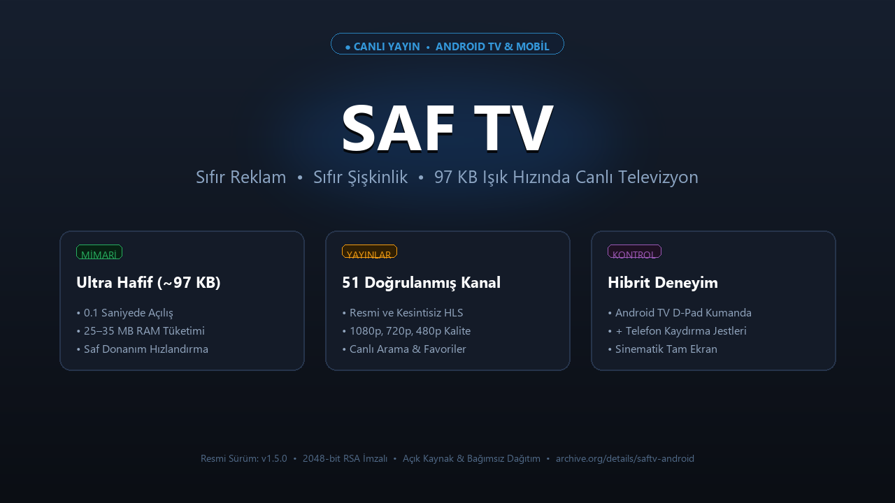

# 📺 Saf TV — Tanıtım ve Okubeni (Android TV, Telefon & Tablet Canlı Yayın Uygulaması)

<p align="center">
  
</p>

<p align="center">
  <a href="https://github.com/devezir/SafTV/releases/latest"></a>
  <a href="#"></a>
  <a href="#"></a>
  <a href="#"></a>
  <a href="#"></a>
  <a href="#"></a>
</p>

---

## ⚡ Hızlı İndirme Bağlantıları

| Dosya | Boyut | Açıklama | Doğrudan İndir |
|---|---|---|:---:|
| 🚀 **Saf TV v2.14.0 (En Son Kararlı - Yasal)** | **~202 KB** | Güncel, resmi imzalı en son APK (Tam Kapsamlı DRY Mimarisi, Akıcı ve Optimize Kod Tabanı) | [⬇️ **SafTV_v2.14.0_vc27.apk İndir**](https://github.com/devezir/SafTV/releases/download/v2.14.0/SafTV_v2.14.0_vc27.apk) |
| 📱 **SafTV.apk (Sabit Bağlantı)** | **~202 KB** | Daima en son stabil sürümü işaret eder | [⬇️ **SafTV.apk İndir**](https://github.com/devezir/SafTV/releases/download/v2.14.0/SafTV.apk) |
| 📦 **Tüm 27 Sürümün Arşivi (ZIP)** | **~2.83 MB** | v1.0.0'dan v2.14.0'a tüm APK'lar tek pakette | [📦 **SafTV_All_Releases_Archive.zip**](https://github.com/devezir/SafTV/releases/download/v2.14.0/SafTV_All_Releases_Archive.zip) |
| 📺 **Kanal Listeleri Kataloğu** | — | M3U8 ve JSON formatında kategori bazlı 120 kanal | [📺 **KANAL_LISTESI.md İncele**](KANAL_LISTESI.md) |
| 📜 **Değişim Günlüğü** | — | Tüm 27 sürümün kronolojik teknik detayları ve bağımsız APK'ları | [📜 **DEGISIM_GUNLUGU.md İncele**](DEGISIM_GUNLUGU.md) |

---

## 🌟 Neden "Saf TV"?

Piyasadaki popüler televizyon uygulamalarının neredeyse tamamı (İnat Box vb.) 30–50 MB boyutundadır; açılışta ve kanal geçişlerinde tam ekran reklamlar, video kütüphaneleri, kullanıcı takipçileri (AdMob, Unity Ads, Firebase, OneSignal) ve cihazı yoran hantal arayüzlerle doludur.

**Saf TV**, bu fazlalıkların tamamından arındırılarak **saf performans, hız ve minimalist estetik** ilkeleri üzerine sıfırdan inşa edilmiştir:

### 📊 Karşılaştırma Tablosu

| Kriter | Sıradan TV Uygulamaları (İnat Box vb.) | 📺 **Saf TV (v2.14.0)** |
|---|---|:---:|
| **Uygulama Boyutu** | 35 MB – 55 MB (Aşırı şişkin) | 🟢 **Sadece 202 KB (250 kat daha hafif!)** |
| **Açılış Hızı (İlk Tıklama)** | 4 – 8 saniye (Bekletici reklamlar ve yükleme) | 🟢 **0.1 saniye (Tıklandığı an canlı yayında)** |
| **Reklamlar & Tanıtımlar** | Var (Açılış, geçiş, banner, video reklam) | 🟢 **SIFIR (%100 Reklamsız, sonsuza dek)** |
| **RAM (Bellek) Tüketimi** | 180 MB – 350 MB (Cihazı ısıtır ve dondurur) | 🟢 **25 MB – 35 MB (Eski TV Box'larda bile yağ gibi)** |
| **Kullanıcı Takipçileri** | 8-15 analitik ve reklam kütüphanesi | 🟢 **SIFIR (İzleyici yok, tam kullanıcı mahremiyeti)** |
| **Video Kod Çözücü** | Şişkin üçüncü parti ExoPlayer paketleri | 🟢 **Android Saf Donanım Hızlandırması (`MediaPlayer`)** |
| **Cihaz Uyumu** | Sadece dokunmatik veya sadece kumanda | 🟢 **Hibrit: Android TV (Kumanda) + Mobil (Dokunmatik)** |
| **Güncelleme Hızı** | Kırık linkler, açılmayan sunucular | 🟢 **GitHub Releases & Raw CDN ile anlık OTA** |

---

## 🚀 Başlıca Özellikler

### 🎛️ 1. 7 Bağımsız Sekmeli Yatay Kayan Ayarlar Menüsü (v2.2.0)
* Kalabalık tercihler menüsü yerine 7 adet bağımsız, hedefe özel sekme:
  * `📋 Kanallar`: Kanal aktif/pasif yönetimi, toplu açma/kapama.
  * `📶 Kalite`: Otomatik, 1080p, 720p, 480p, 360p varsayılan akış kalitesi tercihi.
  * `📏 Görünüm`: %80 - %150 arayüz ve yazı ölçekleme.
  * `🌙 Uyku`: 15-120 dk canlı geri sayımlı uyku zamanlayıcısı.
  * `🎧 Ses Modu`: Ekran kapalıyken yayını radyo gibi dinleme modu.
  * `💾 Yedekleme`: JSON formatında ayarları dışa ve içe aktarma.
  * `ℹ️ Hakkında`: Sürüm durumu ve doğrudan güncelleme denetimi.
* **Akıllı Yatay Kaydırma & Kenar Yumuşatma:** Menünün sağ kenarındaki 28dp'lik gölge geçişi (fading edge) ile kaydırma sezgisel olarak hissedilir.
* **TV Kumandası D-Pad Otomatik Ortalama:** Kumandayla sağa/sola odaklandığınız sekme anında ekranın tam ortasına pürüzsüzce hizalanır.

### 📏 2. Genişletilmiş Arayüz Ölçeği (%60 — %200) (v2.3.0)
* Android TV, Google TV, TV Box, Tablet ve Telefonlar için IPTV & TiviMate endüstri standardı 8 kademeli genişletilmiş ölçekleme mimarisi:
  * `[● Otomatik]`: Cihazı akıllıca tespit eder (Televizyonda %130, Mobilde %100).
  * `[%60 (Ultra Mikro)]`: Tek ekranda 18'den fazla kanal listelemek isteyen kompakt kullanıcılara.
  * `[%80 (Kompakt)]`: Küçük ekranlı telefonlar için ideal yerleşim.
  * `[%100 (Standart Mobil)]`: Standart dikey/yatay mobil düzen.
  * `[%125 (Tablet / Küçük TV)]`: Tabletler veya yakın mesafeden izlenen mutfak TV'leri için.
  * `[%150 (Büyük TV / 3m)]`: 3 metreden kumandayla net okunan standart televizyon boyutu.
  * `[%175 (Dev Ekran / 75"+ TV)]`: 75 inç ve üzeri dev televizyonlar için optimize büyük butonlar.
  * `[%200 (Maksimum Erişilebilirlik)]`: 4+ metre koltuk mesafesinden veya gözlük takmadan rahatça okunan devasa puntolar.
* **Dinamik Çift Yönlü Çekmece Koruması:** Kanal listesi genişliği ölçekle orantılı hesaplanır (`270dp * ölçek`); ekranın %52'sini kesinlikle aşmaz ve %60 ölçekte dahi kanal adlarının kesilmemesi için en az 180dp taban genişliği korunur.

### 📱 3. Resim İçinde Resim (PiP - Yüzen Küçük Pencere)
* Android 8.0 (API 26) ve üzeri cihazlarda üst bardaki `[🗗 PiP]` butonuyla veya yayındayken **Ana Ekran (Home)** tuşuna basıldığında küçülerek ekranda yüzen pencereye geçer.
* WhatsApp'ta yazışırken, internette gezinirken veya başka bir uygulamadayken canlı televizyon yayını kesintisiz devam eder.

### 🌙 3. Akıllı Uyku Zamanlayıcısı
* `Kapalı`, `15`, `30`, `60`, `90`, `120 dakika` seçenekleriyle ayarlanabilir.
* Canlı kalan süre saniye hassasiyetinde (`⏳ 28:45 kaldı`) anlık gösterilir.
* Süre bittiğinde yayını durdurarak uygulamayı nazikçe ve tamamen kapatır (`finishAffinity()`).

### 🎧 4. Ekran Kapalı Dinleme Modu (Arka Planda Ses)
* Telefon kilitlendiğinde veya ekran kapatıldığında yayının sesi çalmaya devam eder.
* Haber, açık oturum veya müzik kanallarını dinlerken muazzam batarya tasarrufu sağlar.

### 🚪 5. Onay Pencereli Güvenli Çıkış
* Canlı yayındayken yanlışlıkla GERİ tuşuna basılması durumunda ekrana şık bir onay kutusu gelir:
  > *"Saf TV'den çıkmak istiyor musunuz? [✕ Vazgeç] [✓ Evet, Çık]"*

### ⏸️ 6. Canlı Yayını Duraklatma & Oynatma
* Dokunmatik ekranda ortadaki `[⏸ / ▶]` butonu veya TV kumandasının Play/Pause tuşları ile canlı yayın anlık dondurulabilir ve tampondan oynatılabilir.

### 🎬 7. Çoklu Çözünürlük & Kalite Seçimi
* `Otomatik`, `1080p Full HD`, `720p HD`, `480p SD` ve `360p Tasarruf` modları.
* Kumandada **Yeşil Tuş**, mobilde ise **[📶 Kalite]** butonu ile tek tıkla hızlı kalite paneli.

### ⭐ 8. Favori Kanallar & Hızlı Arama
* Kumandada **Sarı Tuş**, mobilde ise **[★ Favori]** butonu ile kanalları yıldızlama.
* Çekmece açıldığında arama çubuğuna harf yazıldıkça 61 kanal arasından anında canlı filtreleme.

### 📶 9. Otomatik Ağ Kopması Koruması
* Wi-Fi veya Ethernet koptuğunda kullanıcıyı yormayan akıllı uyarı (`"📶 İnternet Bağlantısı Kesildi!"`).
* İnternet geri geldiği anda canlı yayın otomatik taze bağlantıyla kaldığı yerden devam eder.

### 💾 10. Tarih Damgalı Ayarları Yedekleme & Geri Yükleme
* Tercihleriniz, favorileriniz, aktif/pasif kanallarınız ve arayüz ölçeğiniz `saf_tv_yedek_YYYYMMDD_HHmmss.json` formatında tek tıkla cihaz hafızasına yedeklenebilir ve geri yüklenebilir.

---

## 📦 Tüm 27 Sürümün Ayrı Ayrı APK İndirme Listesi ve Değişim Arşivi

Saf TV'nin v1.0.0 ilk temel sürümünden bugünkü en güncel v2.14.0 sürümüne kadar yayınlanan tüm 27 sürümünün detaylı teknik yeniliklerini ve bağımsız APK indirme bağlantılarını [📜 DEGISIM_GUNLUGU.md](DEGISIM_GUNLUGU.md) dosyasından inceleyebilirsiniz.

| Sürüm | Sürüm Kodu | Boyut | Açıklama | Doğrudan İndir (.apk) |
|:---:|:---:|:---:|:---:|:---:|
| **v2.14.0** | 27 | ~202 KB | Tam Kapsamlı DRY Mimarisi, Optimize Kod Tabanı | [⬇️ SafTV_v2.14.0_vc27.apk](https://github.com/devezir/SafTV/releases/download/v2.14.0/SafTV_v2.14.0_vc27.apk) |
| **v2.13.0** | 26 | ~193 KB | Kalite Menüsünde Çift Katmanlı Canlı Rozet | [⬇️ SafTV_v2.13.0_vc26.apk](https://github.com/devezir/SafTV/releases/download/v2.13.0/SafTV_v2.13.0_vc26.apk) |
| **v2.12.0** | 25 | ~189 KB | OSD Süresi Ayarı & Çift Kademeli Akıllı OK Tuşu | [⬇️ SafTV_v2.12.0_vc25.apk](https://github.com/devezir/SafTV/releases/download/v2.12.0/SafTV_v2.12.0_vc25.apk) |
| **v2.11.0** | 24 | ~185 KB | Sadece Ses (Radyo Modu) Kalıcılığı | [⬇️ SafTV_v2.11.0_vc24.apk](https://github.com/devezir/SafTV/releases/download/v2.11.0/SafTV_v2.11.0_vc24.apk) |
| **v2.10.0** | 23 | ~185 KB | Çıkış Diyaloğuna Ayarlar Erişimi | [⬇️ SafTV_v2.10.0_vc23.apk](https://github.com/devezir/SafTV/releases/download/v2.10.0/SafTV_v2.10.0_vc23.apk) |
| **v2.9.0** | 22 | ~185 KB | Download Klasörüne Dışa Aktarma & 10 Kategori | [⬇️ SafTV_v2.9.0_vc22.apk](https://github.com/devezir/SafTV/releases/download/v2.9.0/SafTV_v2.9.0_vc22.apk) |
| **v2.8.0** | 21 | ~185 KB | Doğrudan TV İçi OTA Güncelleme Motoru | [⬇️ SafTV_v2.8.0_vc21.apk](https://github.com/devezir/SafTV/releases/download/v2.8.0/SafTV_v2.8.0_vc21.apk) |
| ... | ... | ... | *Diğer tüm sürümlerin arşivi için:* | [📜 **Tüm Arşivi Gör (DEGISIM_GUNLUGU.md)**](DEGISIM_GUNLUGU.md) |

---

## 🎮 Kontrol ve Kullanım Rehberi

### 📺 Android TV Kumandası İle:
* **Yukarı / Aşağı Tuşları:** Kanalları değiştirir.
* **Sol / Sağ Tuşları:** Önceki / Sonraki kanala geçer.
* **OK (Orta Tuş):** Ekranın solundan Kanal Listesi Çekmecesini açar.
* **Play / Pause Tuşları:** Canlı yayını duraklatır / devam ettirir.
* **Yeşil Tuş:** Yayın kalitesini seçer (1080p, 720p, 480p).
* **Sarı Tuş:** Kanalı Favorilere (⭐) ekler / çıkarır.
* **Mavi Tuş:** Ekranı tam ekran veya orantılı (16:9 Doğal) yapar.
* **Menü Tuşu:** 4 Sekmeli Ayarlar Menüsünü açar (Kanallar, Tercihler, Yedekleme, Hakkında).
* **Geri Tuşu:** Menüleri kapatır; canlı yayındayken Onaylı Çıkış Penceresini açar.
* **CH+ / CH-:** 5'er kanal hızlı atlar.
* **Rakam Tuşları (0-9):** Doğrudan kanal numarasına zıplar.

### 📱 Telefon & Tablet Dokunmatiği İle:
* **Yukarı / Aşağı Kaydırma:** Sıradaki veya önceki kanala anında geçer.
* **Soldan Sağa Çekme:** Kanal listesi çekmecesini açar.
* **Ekrana Tek Dokunma:** Bilgi kutusunu, üst butonları ve oynat/duraklat tuşunu gösterir / gizler.
* **Ekrana Çift Dokunma:** Ekran oranını değiştirir (*16:9 Doğal / Tam Ekran*).
* **[🗗 PiP] Butonu:** Yayını ekranda yüzen küçük pencereye dönüştürür.
* **Ortadaki [⏸ / ▶] Butonu:** Canlı yayını duraklatır veya devam ettirir.
* **Ekran Butonları:** `[📶 Kalite]`, `[📺 Ekran]`, `[🗗 PiP]`, `[⚙️ Ayarlar]`, `[🚪 Çıkış]`, `[◀ Önceki]`, `[▶ Sonraki]`.

---

## 📋 Uygulamadaki 61 Canlı Kanal Listesi

Tüm yayınlar yayıncı kuruluşların doğrudan resmi CDN sunucularından şifresiz ve yasal HLS (`.m3u8`) protokolüyle çekilir:

```
📺 ULUSAL (14 Kanal)
├── TRT 1 HD
├── Kanal D HD
├── ATV HD
├── Show TV HD
├── Star TV HD
├── NOW TV HD (FOX)
├── TV8 HD
├── Kanal 7 HD
├── A2 TV HD
├── Teve2 HD
├── Beyaz TV HD
├── 360 TV HD
├── TV4 HD
└── TRT Türk HD

📰 HABER & EKONOMİ (16 Kanal)
├── TRT Haber HD
├── NTV HD
├── HaberTürk HD
├── A Haber HD
├── Sözcü TV HD
├── Haber Global HD
├── Halk TV HD
├── 24 TV HD
├── TGRT Haber HD
├── Bloomberg HT HD
├── Tele1 HD
├── TVNET HD
├── Flash Haber HD
├── TRT 3 / TBMM TV HD
├── CNN Türk HD
└── DHA Canlı HD

⚽ SPOR (6 Kanal)
├── TRT Spor HD
├── TRT Spor Yıldız HD
├── A Spor HD
├── TV8.5 HD
├── HT Spor HD
└── FB TV HD

🦁 BELGESEL & YAŞAM (6 Kanal)
├── TRT Belgesel HD
├── DMAX HD
├── TLC HD
├── TGRT Belgesel HD
├── National Geographic Wild HD
└── Çiftçi TV HD

👶 ÇOCUK & EĞİTİM (7 Kanal)
├── TRT Çocuk HD
├── Minika Çocuk HD
├── Minika GO HD
├── TRT Diyanet Çocuk HD
├── TRT EBA İlkokul HD
├── TRT EBA Ortaokul HD
└── TRT EBA Lise HD

🎵 MÜZİK (4 Kanal)
├── TRT Müzik HD
├── Power TV HD
├── Dream Türk HD
└── Kral Pop TV HD

🕌 KÜLTÜR & TEMATİK (8 Kanal)
├── TRT 2 Kültür Sanat HD
├── Diyanet TV HD
├── TRT World HD
├── TRT Avaz HD
├── TRT Arabi HD
├── TRT Kurdî HD
├── Lalegül TV HD (3 Kalite)
└── Semerkand TV HD
```

---

## 📲 Kurulum Rehberi

### 📱 Android Telefon veya Tablete Kurulum:
1. [SafTV_v2.14.0_vc27.apk](https://github.com/devezir/SafTV/releases/download/v2.14.0/SafTV_v2.14.0_vc27.apk) bağlantısına tıklayarak APK dosyasını indirin.
2. İndirilen dosyaya dokunun ve **"Yükle"** deyin *(Bilinmeyen kaynaklara izin vermeniz istenebilir)*.
3. Uygulama saniyesinde açılacak ve canlı yayın hemen başlayacaktır!

### 📺 Android TV veya TV Box'a Kurulum:
* **Yöntem 1 (Kablosuz — En Kolayı):**
  1. Hem telefonunuza hem televizyonunuza Google Play'den ücretsiz **"Send Files to TV"** uygulamasını kurun.
  2. Telefonunuza indirdiğiniz `SafTV.apk` dosyasını bu uygulama üzerinden TV'nize gönderin ve TV'deki dosya yöneticisinden açıp yükleyin.
* **Yöntem 2 (USB Bellek İle):**
  1. `SafTV.apk` dosyasını bir USB belleğe kopyalayın.
  2. USB belleği TV'nize takın ve TV'deki herhangi bir Dosya Yöneticisi ile APK'ya tıklayıp kurun.

---

## 🛠️ Kaynak Koddan Derleme

Saf TV hiçbir harici kütüphane gerektirmez. Saf Android SDK araçlarıyla tek komutta derlenir:

```bash
git clone https://github.com/devezir/SafTV.git
cd SafTV
python build.py
```
*Derleme çıktısı saniyeler içinde kök dizinde üretilir.*

---

## ⚖️ Yasal Uyarı & Lisans

* **Saf TV**, bir yayın sağlayıcısı değildir; bünyesinde herhangi bir video akışı barındırmaz veya saklamaz.
* Uygulamadaki tüm TV yayınları, yayıncı kuruluşların internet üzerinden herkese açık ve şifresiz olarak sunduğu resmi HLS (`.m3u8`) akışlarıdır.
* Saf TV tamamen **açık kaynaklıdır**; ticari bir amaç gütmez, sıfır reklam içerir ve hiçbir kullanıcı verisini toplamaz.

---

<p align="center">
  <b>Saf TV — Gerçekten Saf, Işık Hızında Televizyon Deneyimi.</b><br/>
  Geliştirici: <a href="https://github.com/devezir">@devezir</a>
</p>
